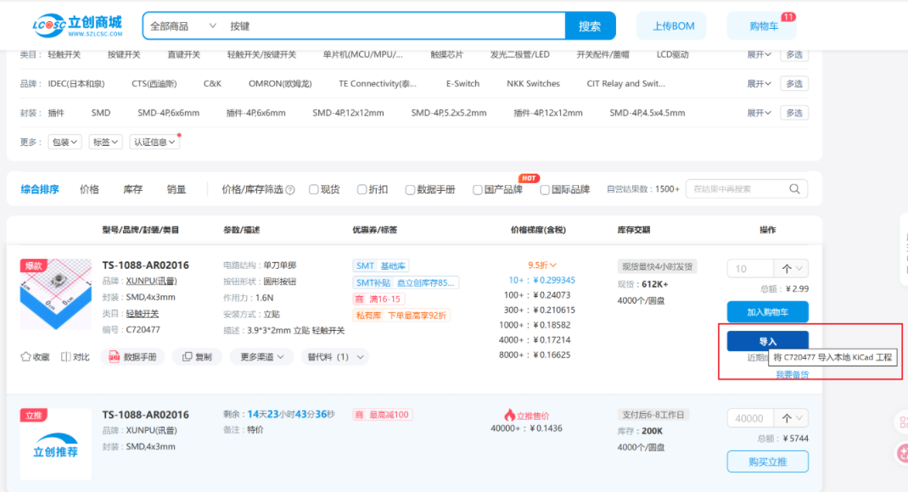

# LCSC → KiCad

在浏览器里逛立创商城，点一下页面上的「导入」，符号、封装和 3D 模型就写进你的 KiCad 工程。



## 用法

**1. 下载**：在 [Releases](https://github.com/betwowt/lcsc-browser-kicad-bridge/releases) 里选对应平台，解压。

**2. 启动本地服务**：首次运行会让你选 KiCad 工程目录（包含 `.kicad_pro` 的那个）。

```bash
LCSC-KiCad-Bridge.exe          # Windows，双击也行
xattr -dr com.apple.quarantine LCSC-KiCad-Bridge && ./LCSC-KiCad-Bridge   # macOS
chmod +x LCSC-KiCad-Bridge && ./LCSC-KiCad-Bridge                        # Linux
```

看到 `listening on http://127.0.0.1:8737` 就别关窗口。

**3. 装扩展**：Chrome / Edge 同一份。已上架就从商店安装；没上架就打开 `chrome://extensions`，
开启开发者模式，「加载已解压的扩展程序」选 `extension/`。

**4. 导入**：打开商品页（右下角「导入 KiCad」）或搜索结果页（卡片右侧「导入」），点一下。
元件会出现在工程的 `LCSC/` 目录，库表里多一个 `LCSC` 库。KiCad 已经开着的话，重开编辑器才能看到新库。

扩展选项里点「测试连接」能看到当前工程路径。要换工程：点「打开工程设置」（或直接开
`http://127.0.0.1:8737/settings`），选好目录保存，立即生效；已经打开的 KiCad 编辑器要重开才能刷新库表。

## 它做了什么

扩展只负责在页面插按钮并把料号发给本机服务；下载、转换、写库由
[LCSC_Kicad_import](https://github.com/silencewwh/LCSC_Kicad_import) 完成，本项目以 submodule 固定在
`vendor/LCSC_Kicad_import`，没有复制代码。转换器来自
[easyeda2kicad.py](https://github.com/uPesy/easyeda2kicad.py)，导入器原型来自
[Import-LIB-KiCad-Plugin](https://github.com/Steffen-W/Import-LIB-KiCad-Plugin)。

许可证 AGPL-3.0，完整署名见 [THIRD_PARTY_NOTICES.md](THIRD_PARTY_NOTICES.md)。

## 开发与发版

```bash
git clone --recurse-submodules git@github.com:betwowt/lcsc-browser-kicad-bridge.git
cp server/config.example.json server/config.json   # 填 project_dir
python server/bridge_server.py --config server/config.json
```

打包需要 PyInstaller：`python tools/build_portable.py`，产物在 `dist/`。
发版改两处版本号（`server/bridge_server.py` 的 `VERSION`、`extension/manifest.json` 的 `version`），
然后 `git tag bridge-v1.2.0 && git push origin bridge-v1.2.0`，CI 会构建三平台并创建 Release。
